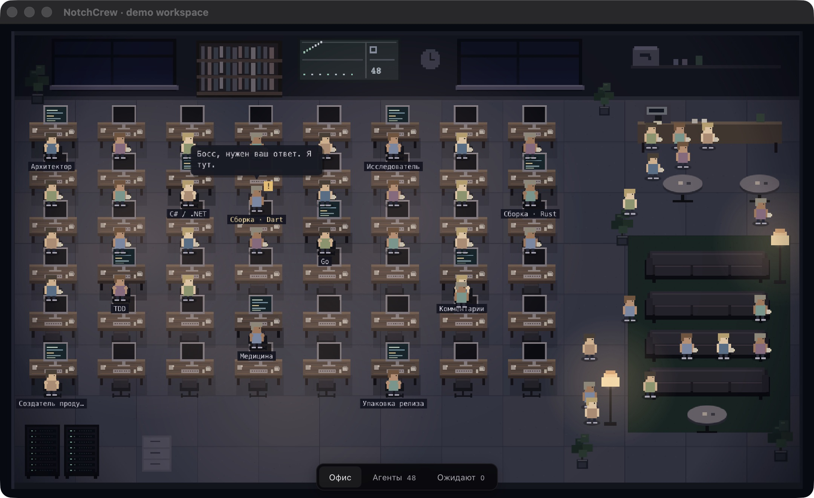

# NotchCrew

**Your AI crew, one glance away.** A local macOS notch companion with a pixel office, live agent activity, media controls, clipboard history, notes, and a keep-awake timer.

[Download for Apple Silicon](https://github.com/DevZair/notchcrew/releases/latest) · [Report a bug](https://github.com/DevZair/notchcrew/issues) · [Contribute](CONTRIBUTING.md)



*Demonstration with synthetic agent data.*

> **Early release · Russian interface · Tested on macOS 26 / Apple Silicon.** Earlier macOS versions are experimental; media integration may be unavailable. Intel Macs are not supported by the bundled media helper.

## What it does

- **A living pixel office.** Characters work, wait, and take breaks according to observed local agent activity. Speech bubbles are decorative; status comes from real events.
- **Codex and Claude Code activity.** Read local sessions, see active tasks, and handle supported permission requests through optional hooks.
- **Clipboard with memory.** Save text and PNG/TIFF images across restarts, preview images, and copy an entry back for pasting. Pause collection, delete an item, or clear history.
- **Now playing.** See artwork and playback progress, with previous/play/pause/next controls for apps that publish system media information.
- **Keep your Mac awake.** Run a timed keep-awake session, optionally keeping the display on. Manual sleep and closing the lid still work.
- **Quick local notes.** A small writing space beside your other notch tools.

NotchCrew **observes your existing agents**. It does not create agents, buy model access, launch tasks, or distribute work. The office supports up to 48 role slots, discovered from your local Codex/Claude role definitions. Without role definitions, the role roster is empty; ordinary sessions are shown separately.

## Install

1. Install **Python 3.10+** if it is not already available. The app checks `/opt/homebrew/bin/python3`, `/usr/local/bin/python3`, then `/usr/bin/python3`; a version-manager-only installation may not be found.
2. Download `NotchCrew-macOS-arm64.zip` from [Releases](https://github.com/DevZair/notchcrew/releases/latest) and unzip it.
3. Move **NotchCrew.app** to **Applications**, then open it.
4. Hover over or click the notch to open the panel. Double-press the **right ⌘ key** to open the office.

The release uses a local ad-hoc signature and is **not Apple-notarized**. macOS may block the first launch. If you trust this download, use **System Settings → Privacy & Security → Open Anyway** after attempting to open it. No command that disables Gatekeeper is required. Checksums are provided with each release.

The app has no Dock icon. Use its menu-bar item to open panels or quit. The app does not automatically register a login item; add it in macOS Login Items if you want it to start after signing in.

### Connect your agents

Codex activity is discovered from existing local session logs. Role definitions are read from `~/.codex/agents/` and `~/.claude/agents/`. Provider formats can change; missing or stale evidence should be treated as an unknown status.

**Optional hooks:** clone this repository and run only the installer you need, after moving the app to `/Applications/NotchCrew.app`:

```bash
# Claude Code: activity events and supported permission/question replies
python3 source/install_hooks.py

# Codex: supported PermissionRequest events
python3 source/install_codex_hooks.py
```

These commands update the provider's local hook configuration and make backups. They do not change permission policies. For Codex, review and trust the NotchCrew hook in `/hooks` if your installed version supports that flow, then start or resume a session that loads it. Integration depends on your provider version; not every Codex surface exposes the same hooks. Already-authorized actions do not produce approval requests. Lock-screen decisions require macOS authentication.

### Shortcuts

| Action | Shortcut |
| --- | --- |
| Open office | Double-press right ⌘ |
| Open standalone office window | ⌘1 |
| Pending requests | ⌘2 |
| Clipboard | ⌘3 |
| Notch panel | ⌘4 |
| Close panel | Escape |

Numbered shortcuts are app menu shortcuts, not system-wide hotkeys.

## Privacy and storage

NotchCrew works locally and does not send session logs, notes, or clipboard entries to a server. It reads local provider logs and a read-only Codex title index to label sessions. Optional hooks write local events and pending requests.

- App data: `~/Library/Application Support/NotchCrew/`.
- Clipboard: up to **30 entries**, bounded to **48 MiB** of entry data. Text entries are limited to 64 KiB; canonical PNG images to 8 MiB. Oversized or unsupported content is skipped. Images are stored as PNG; animation and original file metadata are not preserved.
- Clipboard history is **stored on disk without app-level encryption**. Known concealed/confidential pasteboard types are excluded, but an unmarked secret can still be captured. Use Pause or Clear when needed.
- Notes are stored locally in the app's preferences. Artwork is held in memory. There is no cloud sync.

See [SECURITY.md](SECURITY.md) for reporting and data-handling details.

## Build and test

Requirements: Apple Silicon Mac, Apple Command Line Tools (`xcode-select --install`), Python 3.10+, and Node.js 20+ for tests. No npm or pip packages are required.

```bash
git clone https://github.com/DevZair/notchcrew.git
cd notchcrew
./setup.sh               # Build an ad-hoc signed release archive
./scripts/test.sh        # Python, JavaScript and native Swift tests
./scripts/install.sh     # Copy the build to /Applications (does not overwrite)
```

Build output: `dist/NotchCrew-macOS-arm64.zip` and `dist/SHA256SUMS`. Setup does not install hooks, change agent permissions, or launch the app.

See [AGENTS.md](AGENTS.md) for architecture and commands, and [CONTRIBUTING.md](CONTRIBUTING.md) for development guidance.

## Using with Codex

Open this repository in Codex, or run `codex` from the repository directory. [AGENTS.md](AGENTS.md) describes the native shell, local collector, pixel scene, and tests. It also identifies privacy boundaries and optional integrations.

## Limitations

- The current interface is Russian. English localization is a welcome contribution.
- The native shell targets macOS 14+, but the bundled media helper comes from a macOS 26 build. Only macOS 26 on Apple Silicon has been tested as a complete package.
- Media controls use a bundled MediaRemote adapter and can break after a macOS update. Media support varies by source app.
- Agent status is observed telemetry, not a guarantee that a model is currently generating tokens. This app cannot make a single-agent task run in parallel.
- The app is distributed outside the App Store, without notarization or an automatic updater.

## Uninstall

If you installed optional hooks, remove them **before** removing the app:

```bash
python3 source/install_codex_hooks.py --remove
python3 source/uninstall_hooks.py
```

Quit NotchCrew, move `/Applications/NotchCrew.app` to the Trash, and remove any login item you added. To delete saved history, remove `~/Library/Application Support/NotchCrew/` in Finder. Notes are stored in app preferences separately.

## Make it yours

If NotchCrew makes your daily workflow nicer, **[give the repository a star](https://github.com/DevZair/notchcrew)**. Bug reports, localization, and small focused improvements are equally welcome.

## License

[MIT](LICENSE) for NotchCrew. The bundled media helper and adapter retain their own BSD license and notices in [`vendor/MediaControl/`](vendor/MediaControl/).

---

**По-русски:** NotchCrew — офис агентов и полезные инструменты в чёлке Mac. Интерфейс уже на русском. Скачайте архив из Releases, перенесите приложение в «Программы» и откройте. Нужны Apple Silicon, Python 3.10+; полная сборка проверена на macOS 26. Приложение показывает существующие локальные сессии, а не запускает 48 агентов самостоятельно.
